<p align="center"></p>

Pick an app. Check its record. The badge brings you here so you can see the source, version and hash for yourself. This repo keeps the catalog, builds the SVG/PNG badges and Project medal, and gives you the README snippets. Run it locally; publication is a separate owner action. Nothing pushes, contacts an app or queries a console by itself.

**All included records are demonstrations.** Sample commits, versions, hashes and `.invalid` evidence URLs are synthetic; no review, real-console acceptance or signed org release is asserted. Real records start with the first app release built by the org CI.

## Levels and ownership

1. **Revive360 Project**: inside the org, continuous rules/security/review, organization CI release with signed provenance; green mascot badge.
2. **Reviewed · vX.Y.Z**: external author builds; org checks the exact version/hash/source/date. Changes return to FIFO manual review, 14-day target; badge says current version not reviewed. No org update channel. Contact disappearance expires the badge.
3. **Community list**: discovery only, no badge; fixed warning and removable at any time.

Security response at all levels: 48 hours, severe findings revoke immediately. The org takes responsibility for its repos and reviewed external versions within [the review scope](https://github.com/revive360/.github/blob/main/REVIEW.md), never a full audit/warranty. Founder Pedro alone may review his own app, including at the highest level; records explicitly mark the exception. Membership is not a badge; unlisted member repos are the author's responsibility. Software is as is under its license. No donations received/split.

## Run the catalog

Bring Python 3.12+. Install the pinned dependencies, run the checks and build the pages:

```sh
python3 -m venv .venv
.venv/bin/pip install -r requirements.txt
.venv/bin/python -m unittest discover -s tests -v
.venv/bin/python -m catalog.build --as-of 2026-11-25
```

Take a look at [generated/index.html](generated/index.html), [the catalog index](generated/README.md) or grab the [README snippets](generated/snippets.md). Keep the record link attached when you use a badge. The committed snapshot uses a fixed date so it is reproducible. For operational refresh use `.venv/bin/python -m catalog.build` (today), never the fixture date. `--data` and `--output` select separate directories; generation validates every record before replacing generated files and removes stale badges. Output must be empty or carry the generator's `.catalog-generated` marker; unrelated directories are refused.

README badges use two parts: mascot + **Revive360**, then a distinct vector icon, word and palette for each state. **Official** with a star is the highest, continuous Project level: dark with a bright neon-green border/glow. **Reviewed vX.Y.Z** has a check mark and sober teal; **Outdated vX.Y.Z** has a warning triangle and amber (the displayed version is the historical review); **Expired** has an hourglass and gray; **Revoked** has a cross and red. Icons are SVG paths, never emoji glyphs. Text sits on opaque fills for legibility in light and dark README themes. Accessible titles and snippets identify the state. The approved Project medal is unchanged. **No SVG/PNG includes a demo label**; the preview shows it outside the image, with a Portuguese legend next to each state. PNGs use pinned `resvg-py` with the bundled licensed font and no system-font lookup. See [asset provenance](assets/README.md).

`data/apps/<id>.json` is validated using Draft 2020-12 [JSON Schema](schema/app.schema.json), date/URI format checking and semantic rules. For reviewed entries the generator derives status from current version/source/hash, expiry and revocation. Status cannot be set to valid by an author-supplied string. Reviewers and evidence still need **human approval**: local schema validation cannot prove source/binary correspondence, actual repository ownership, console testing or attestation validity. For real records set `example: false` only after reviewing actual evidence; illustrated console results and `.invalid` evidence are rejected.

## Maintaining trust

- A badge is a **link to its app record**, not a standalone signature. The record displays reviewed and latest recorded hashes/versions, reviewer, date, evidence, expiry/revocation reason and limitations. Copying a badge does not alter its authoritative link target. Users must check that link; malicious authors can also replace links or serve stale screenshots.
- Revocation takes precedence over expiry and unreviewed updates; expired reviews retain history. Project status has no external expiry. Community receives no SVG. Revoked tombstones remain so copied badges can be refuted.
- Authors report updates/changed assets. Maintainers check external releases at least weekly and log each received review request, version/hash and FIFO outcome in catalog issues. Start from [REVIEW_REQUEST.md](REVIEW_REQUEST.md). No read-only upstream monitor exists yet; current status means latest **recorded** data, never a live guarantee.
- External contact policy starts at 90 days plus a 14-day response window, encoded by `author_confirmed_on`/`expires_on` (maximum 104 days). Update only after author confirmation; contact does not approve a new binary. New policy durations require coordinated schema/semantic/test and governance updates.
- `.github/workflows/ci.yml` is prepared, not executed remotely. It validates/tests, reproduces the fixture snapshot and renders today's statuses as a 7-day artifact. It **does not deploy** that artifact or refresh public badges. The owner must publish reviewed status changes. SHA-pinned Actions, read-only permissions, hosted Linux runner; DCO checks every PR commit. No workflow inheritance is assumed.

## Put the whole thing on the table

Keep `.github` and `devkit` next to this checkout, then make the owner preview:

```sh
.venv/bin/python scripts/preview.py --output build/preview/index.html
```

One file to pass around: profiles in three languages, all first-party Markdown docs, readable issue forms, app records, badges and the mascot. Open it offline. No CDN, remote fonts or image requests. The standalone catalog index also works on its own. Upstream license texts keep their source links and are not presented as house policy.

**Risk/privacy:** Homebrew can cause Xbox Live bans, data loss or console damage. No collection without opt-in; login/tokens stay on the console. Third-party terms risk is the author's; no DRM/paywall bypass. Use private vulnerability reporting and [official Discussions](https://github.com/orgs/revive360/discussions) until the org email is confirmed in December.

Code/docs are MIT; branding and upstream notices retain their separate rights. [GitHub setup checklist](https://github.com/revive360/.github/blob/main/SETUP.md) and [Free CI plan](https://github.com/revive360/.github/blob/main/CI.md).
