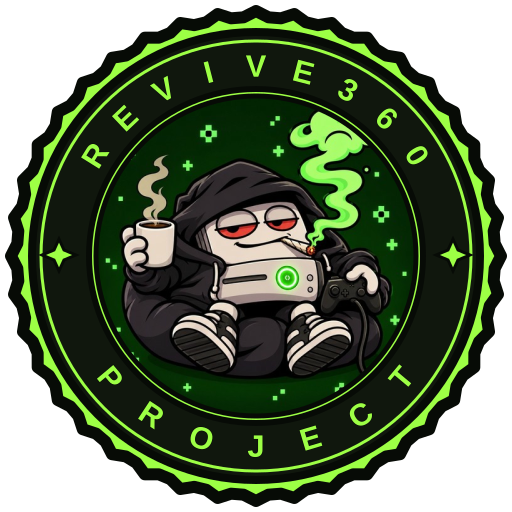
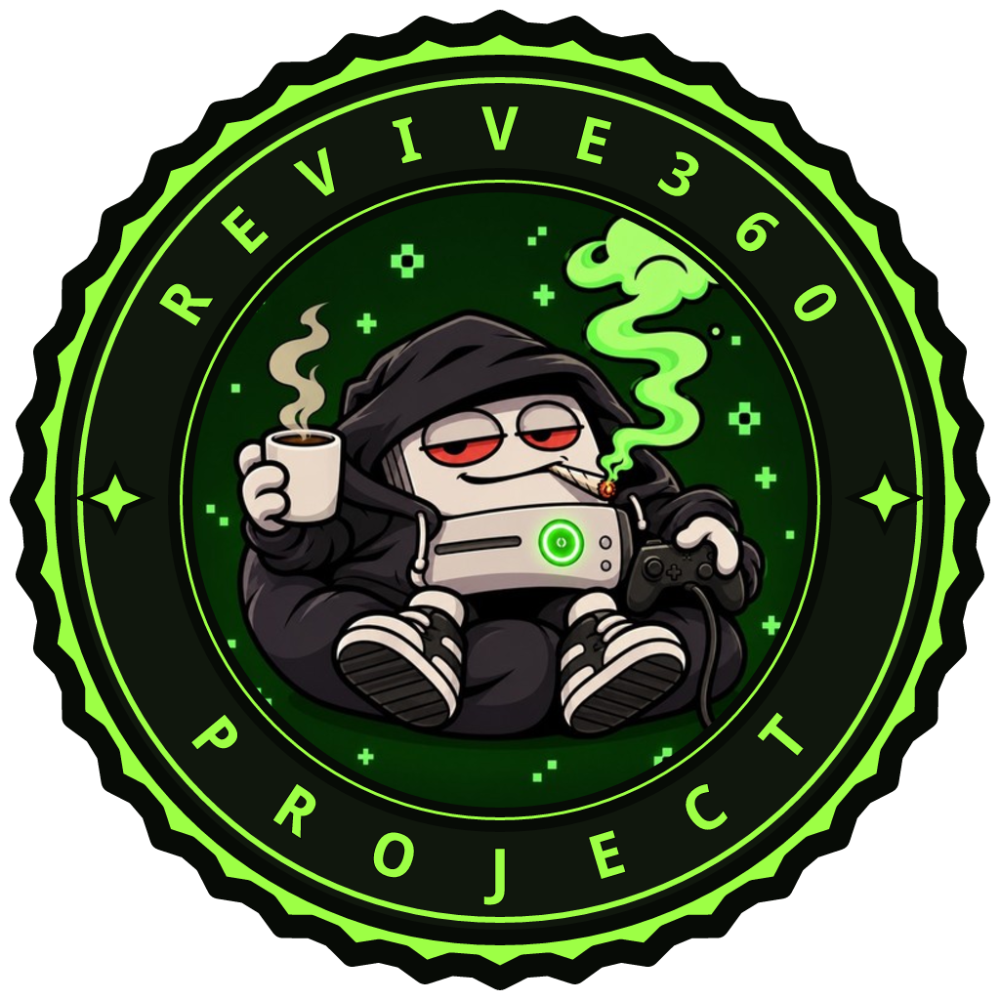

# Sample Project app

**Revive360 Project — Valid**

Check the source, version and hash. The badge links here for a reason.

Status calculated on **2026-11-25** from the recorded data; not live upstream monitoring.

> **DEMONSTRATION ONLY — not a certification.** Demonstration only\. No real app, review, real\-console test or signed CI release is claimed\. Version, commits, hashes and evidence are synthetic\.


How a Revive360 Project record looks\.

Repository: https://github.com/revive360/sample-project

Owner: PedroHenrique0713. License: MIT. Membership is not a badge.

## Reviewed release (2026-11-25)

Version: **v1.2.3**. Reviewer: **PedroHenrique0713**.

Founder self-review exception: **true**.

Source commit: `1111111111111111111111111111111111111111`

SHA-256: `9451b61b23b1ce70e8b5c36107702e495637bdd883845f047a7e7b7e79c2c46e`

Author/CI artifact: https://example.invalid/illustration.zip

Build producer: **org-ci**. Review evidence: https://example.invalid/review

Real-console result: **illustration**. Record: https://example.invalid/console

ci_run_url: https://example.invalid/ci

attestation_url: https://example.invalid/attestation

## Current recorded release

Version: **v1.2.3**

Source commit: `1111111111111111111111111111111111111111`

SHA-256: `9451b61b23b1ce70e8b5c36107702e495637bdd883845f047a7e7b7e79c2c46e`

## Scope and user risk

Review is not a complete audit or warranty. Software is as is under its license. Homebrew risks Xbox Live bans, data loss and console damage. No collection without opt-in; login/tokens stay on the console. No DRM/paywall bypass. Third-party terms risk belongs to the author.

[Review policy, checklist, response priorities and limits](https://github.com/revive360/.github/blob/main/REVIEW.md). Security response: 48 hours; severe findings revoke immediately. External review queue: FIFO, 14-day target.

## Put it in your README

```markdown
[](https://github.com/revive360/catalog/blob/main/generated/apps/sample-project.md)
```

[Back to catalog](../README.md)

## Put the Project medal up top



```markdown
[](https://github.com/revive360/catalog/blob/main/generated/apps/sample-project.md)
```

PNG alternative:

```markdown
[](https://github.com/revive360/catalog/blob/main/generated/apps/sample-project.md)
```
