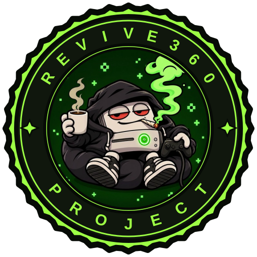
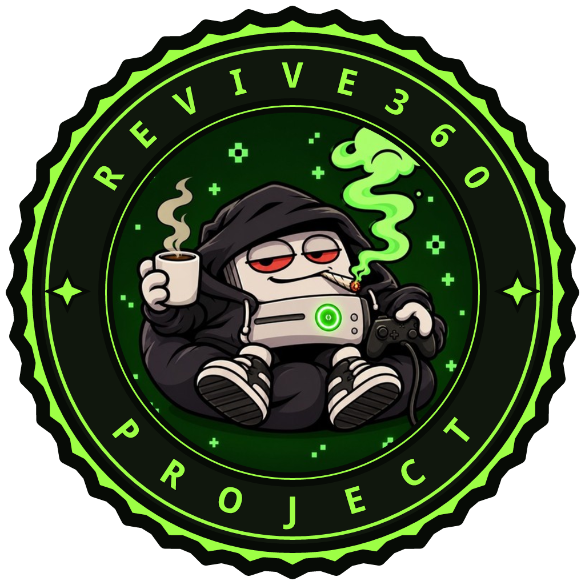

# Tube360

**Revive360 Project — Valid**

Check the source, version and hash. The badge links here for a reason.

Status calculated on **2026-11-26** from the recorded data; not live upstream monitoring.


Native YouTube app for the Xbox 360: browse, search, play up to 1080p30, YouTube Music and Nest audio, all on the console\.

Repository: https://github.com/revive360/tube360

Owner: PedroHenrique0713. License: MIT. Membership is not a badge.

## Reviewed release (2026-11-26)

Version: **v0.3.3**. Reviewer: **PedroHenrique0713**.

Founder self-review exception: **true**.

Source commit: `092607e71f24ae6211c20e1f094194498b7621b7`

SHA-256: `095f2b806a492a7cd29d3d6694aaca079fc4adb5da1aacf166b5c90e1465af9f`

Author/CI artifact: https://github.com/revive360/tube360/releases/download/v0.3.3/tube360-v0.3.3-xbox360.zip

Build producer: **org-ci**. Review evidence: https://github.com/revive360/catalog/issues/1

Real-console result: **passed**. Record: https://github.com/revive360/catalog/issues/1

ci_run_url: https://github.com/revive360/tube360/actions/runs/45916404405

attestation_url: https://github.com/revive360/tube360/attestations/72888615

## Current recorded release

Version: **v0.3.3**

Source commit: `092607e71f24ae6211c20e1f094194498b7621b7`

SHA-256: `095f2b806a492a7cd29d3d6694aaca079fc4adb5da1aacf166b5c90e1465af9f`

## Scope and user risk

Review is not a complete audit or warranty. Software is as is under its license. Homebrew risks Xbox Live bans, data loss and console damage. No collection without opt-in; login/tokens stay on the console. No DRM/paywall bypass. Third-party terms risk belongs to the author.

[Review policy, checklist, response priorities and limits](https://github.com/revive360/.github/blob/main/REVIEW.md). Security response: 48 hours; severe findings revoke immediately. External review queue: FIFO, 14-day target.

## Put it in your README

```markdown
[](https://github.com/revive360/catalog/blob/main/generated/apps/tube360.md)
```

[Back to catalog](../README.md)

## Put the Project medal up top



```markdown
[](https://github.com/revive360/catalog/blob/main/generated/apps/tube360.md)
```

PNG alternative:

```markdown
[](https://github.com/revive360/catalog/blob/main/generated/apps/tube360.md)
```
