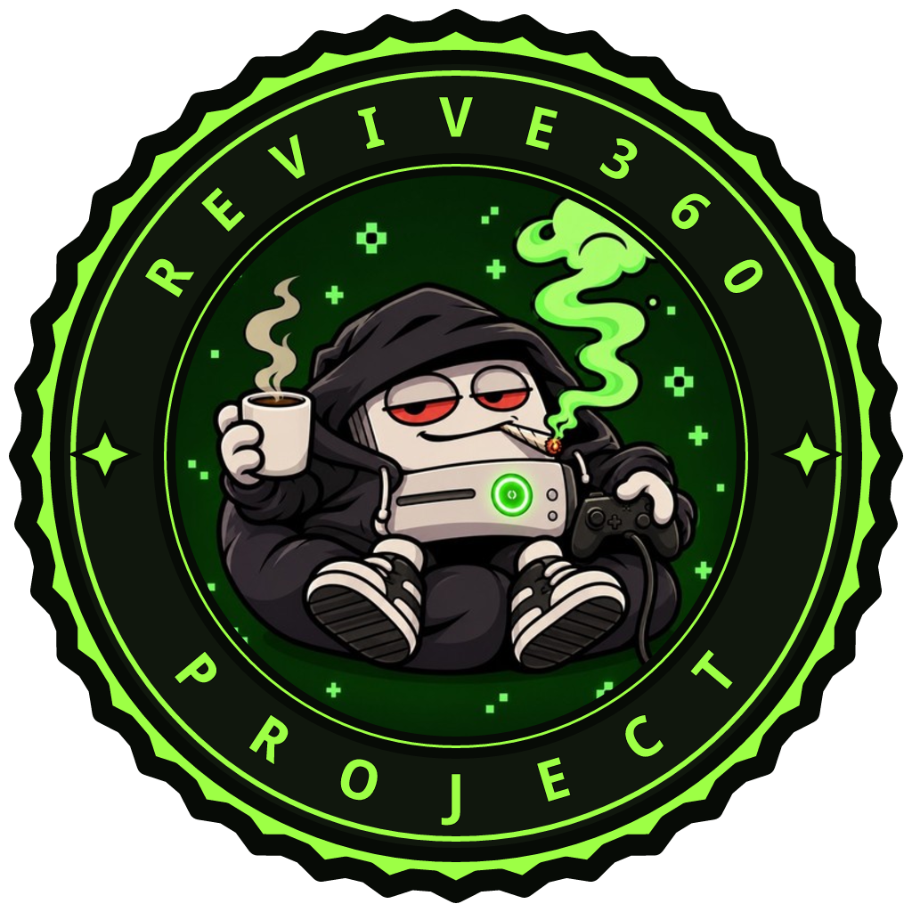
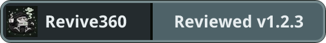

# README badge snippets

Grab the SVG or PNG. Keep the record link attached.

Examples link to demonstration records. SVG assets contain no demo label; inspect the linked record before use.

## sample-community

Compact SVG:

```markdown
No badge for Community list.
```

## sample-expired

Compact SVG:

```markdown
[](https://github.com/revive360/catalog/blob/main/generated/apps/sample-expired.md)
```

Compact PNG:

```markdown
[](https://github.com/revive360/catalog/blob/main/generated/apps/sample-expired.md)
```

## sample-project

Compact SVG:

```markdown
[](https://github.com/revive360/catalog/blob/main/generated/apps/sample-project.md)
```

Compact PNG:

```markdown
[](https://github.com/revive360/catalog/blob/main/generated/apps/sample-project.md)
```

Project medal (SVG):

```markdown
[](https://github.com/revive360/catalog/blob/main/generated/apps/sample-project.md)
```

Project medal (PNG):

```markdown
[](https://github.com/revive360/catalog/blob/main/generated/apps/sample-project.md)
```

## sample-reviewed

Compact SVG:

```markdown
[](https://github.com/revive360/catalog/blob/main/generated/apps/sample-reviewed.md)
```

Compact PNG:

```markdown
[](https://github.com/revive360/catalog/blob/main/generated/apps/sample-reviewed.md)
```

## sample-revoked

Compact SVG:

```markdown
[](https://github.com/revive360/catalog/blob/main/generated/apps/sample-revoked.md)
```

Compact PNG:

```markdown
[](https://github.com/revive360/catalog/blob/main/generated/apps/sample-revoked.md)
```

## sample-unreviewed

Compact SVG:

```markdown
[](https://github.com/revive360/catalog/blob/main/generated/apps/sample-unreviewed.md)
```

Compact PNG:

```markdown
[](https://github.com/revive360/catalog/blob/main/generated/apps/sample-unreviewed.md)
```

## tube360

Compact SVG:

```markdown
[](https://github.com/revive360/catalog/blob/main/generated/apps/tube360.md)
```

Compact PNG:

```markdown
[](https://github.com/revive360/catalog/blob/main/generated/apps/tube360.md)
```

Project medal (SVG):

```markdown
[](https://github.com/revive360/catalog/blob/main/generated/apps/tube360.md)
```

Project medal (PNG):

```markdown
[](https://github.com/revive360/catalog/blob/main/generated/apps/tube360.md)
```
