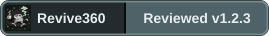
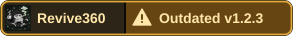

# README badge snippets

Demonstrations only; do not use as live certification.

## sample-community

```markdown
No badge for Community list.
```

## sample-expired

```markdown
[](https://github.com/revive360/catalog/blob/main/generated/apps/sample-expired.md)
```

## sample-reviewed

```markdown
[](https://github.com/revive360/catalog/blob/main/generated/apps/sample-reviewed.md)
```

## sample-revoked

```markdown
[](https://github.com/revive360/catalog/blob/main/generated/apps/sample-revoked.md)
```

## sample-unreviewed

```markdown
[](https://github.com/revive360/catalog/blob/main/generated/apps/sample-unreviewed.md)
```

## tube360

```markdown
[](https://github.com/revive360/catalog/blob/main/generated/apps/tube360.md)
```
